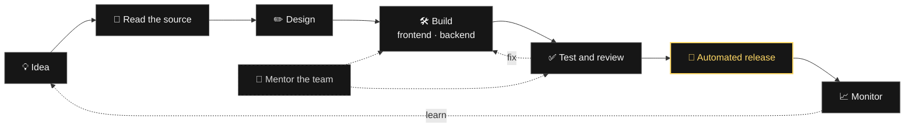

<p align="center">
  
</p>

<h3 align="center">I build the parts of web3 that users never see, and the parts they do.</h3>

<p align="center">
  
  
  
  
  
  
  
  
  
  
</p>

## 🌱 My career as a git log

```text
% git log --oneline career

* 2026 (HEAD -> main)  feat(rust): research and engineering on real-time data systems
* 2025                 feat(privacy): website, governance app and block explorer
* 2024                 feat(defi): liquidator, price feed and sdk for a lending protocol
* 2023                 feat(zk): developer toolkit and bridge for a zero-knowledge chain
* 2022 (tag: lead)     feat(team): start leading and mentoring a team
* 2022                 feat(game): backend, migration and monitoring for a web3 game
* 2021                 feat(web3): first web3 frontends
* 2020                 feat(video): frontend lead for a video transcription product
* 2019                 chore(init): first production frontend work
```

## 🧩 How I work



## 🗺️ Where I work in the stack

```sql
SELECT layer, tools FROM stack ORDER BY depth;
```

```text
   layer   |                           tools
-----------+-----------------------------------------------------------
 interface | React · Next.js · React Native · wagmi · viem
 api       | Rust · Tokio · Axum · Node.js · gRPC · WebSocket · WebRTC
 data      | PostgreSQL · ClickHouse · NATS · indexers
 chain     | Solidity · bridges · relayers · SDKs
 delivery  | Docker · Kubernetes · CI/CD
(5 rows)
```

## 🚀 What I have built

**Web3**

| What I worked on | What I did |
| --- | --- |
| 🧰 Developer toolkit for a zero-knowledge blockchain | Core contributor to the CLI and SDK |
| 🌉 Cross-chain bridge between a zero-knowledge chain and Ethereum | Built the database service, and contributed to the backend and frontend |
| 🕶️ Website, governance app, and block explorer for a privacy protocol | Built most of the website and explorer, and contributed to governance |
| 💸 Cross-chain DeFi lending protocol | Built the liquidator and price feed services, and contributed to the frontend and SDK |
| 🎮 Web3 game on Ethereum | Built most of the backend, plus the migration and monitoring services |
| 🖼️ NFT minting, rental, and upgrade system | Led the team |
| 🔑 Wallet and transaction automation backend | Designed the wallet layer and event listeners |

**Web and mobile**

| What I worked on | What I did |
| --- | --- |
| 🎬 Video transcription product | Led the frontend, and built the transcript interface and widgets |
| 🧠 Talent assessment platform | Led the frontend, and built game and training modules with per-client branding |
| 📞 Telecom subscription management system | Built the web and mobile apps with React and React Native |
| 🎓 Marketing website for an online learning platform | Built pages and components with Next.js |
| 🕹️ Real-time multiplayer trivia game with voice and video calls | Built the mobile app with React Native, Socket.io, and WebRTC |

## 📫 Contact

```http
POST /contact HTTP/1.1
Host: poudelanil.com.np
Content-Type: application/json

{ "topic": "web3, Rust, or a product idea" }
```

<p align="center">
  <a href="mailto:hello@poudelanil.com.np"></a>
  &nbsp;&nbsp;
  <a href="https://www.linkedin.com/in/pdlanl"></a>
</p>
